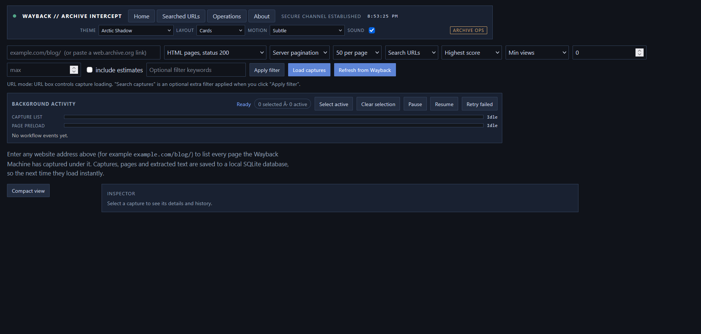
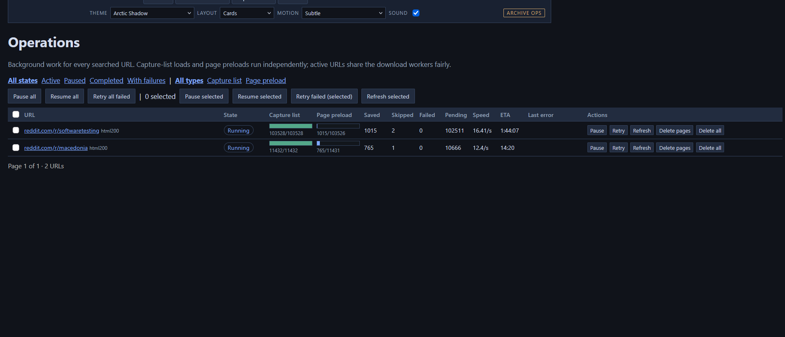
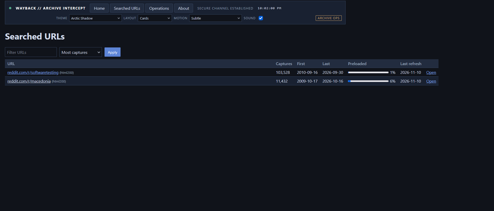
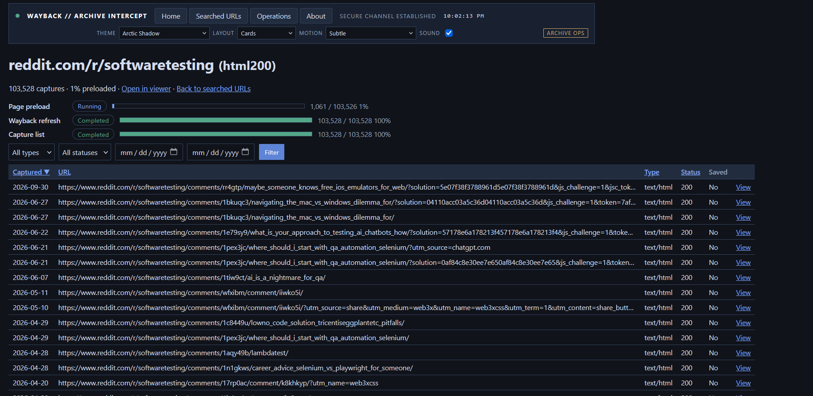
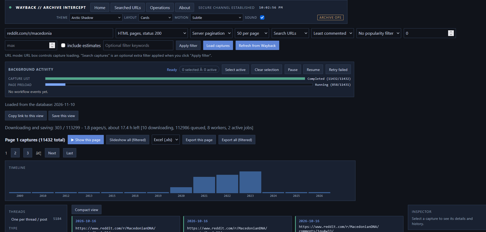
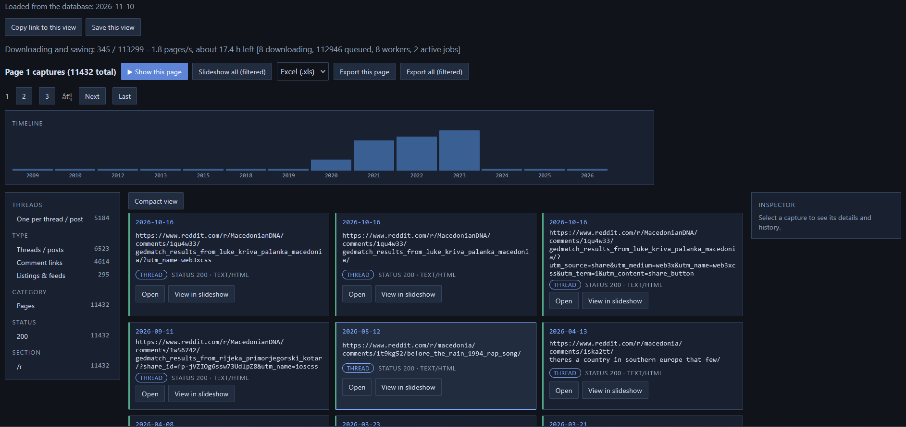

# Wayback Viewer

<p align="center">
  
</p>

<p align="center">
  <a href="./LICENSE"></a>
  
  
</p>

## Demo & Screenshots

### 📹 Video Demo
**[Watch the demo video](https://github.com/BFilipB/WaybackViewerFinal/releases/download/v1.0.0/demo.mp4)** – See WaybackViewer in action: browse archived captures, filter results, and instantly replay archived pages.

### 📸 Screenshots

| Home Screen | Operations Page |
|---|---|
|  |  |

| Searched URLs | URL Detail View |
|---|---|
|  |  |

| Home Page with Captured URL | Card View of Captures |
|---|---|
|  |  |

Wayback Viewer is a .NET 8 web app for loading website capture lists from the Internet Archive, browsing captures quickly,
and persisting metadata + archived payloads for fast local replay.

This README is intentionally comprehensive: setup, architecture, navigation, operations model, search behavior,
configuration, and troubleshooting.

### Documentation navigation

- [What the app does](#1-what-this-app-does)
- [Quick start](#2-quick-start) and [storage setup](#3-setup-and-storage-paths)
- [First search and popularity guide](#3b-guides)
- [Databases](#3c-databases-and-adaptability), [Docker](#3d-docker), and [testing/CI](#3e-testing-ci-and-cd)
- [Troubleshooting](#3g-troubleshooting)
- [Complete screen-by-screen navigation guide](#5-main-user-navigation-ui-guide)
- [Search behavior](#6-search-behavior-important) and [background operations](#7-background-operations-model)
- [Configuration reference](#8-configuration-reference) and [endpoints](#9-endpoints)
- [Reliability, backup, and safety](#10-reliability-and-pitfalls-known--handled)
- [Database setup and providers](./docs/DATABASES.md)
- [Popularity documentation index](./docs/popularity/README.md)
- [Step-by-step popularity guide](./docs/popularity/GUIDE.md)
- [Popularity roadmap](./docs/popularity/roadmap.md) and [experiment history](./docs/popularity/experiments.md)

Some popularity documents retain historical plans; current behavior and remaining limitations are summarized below.

---

## Open-source license

This project is open source under the **MIT License**.

- Full text: [`LICENSE`](./LICENSE)
- You can use, modify, and redistribute this project (including commercially) under MIT terms.

---

## 1) What this app does

Given a site/prefix (for example `example.com/blog/`), the app can:

1. Load capture metadata from Wayback CDX.
2. Save and reuse that list locally.
3. Background-download page content for local replay.
4. Browse captures in list + slideshow views.
5. Search by URL or by captured page content.
6. Export text across current page or full filtered result set.

It is built for large sets and resumable background workflows.

### A few terms before starting

| Term | Plain-language meaning |
|---|---|
| Internet Archive / Wayback Machine | The external service that holds archived copies of websites. This app is a browser and local cache for those copies, not the archive itself. |
| URL prefix | The beginning of the website address you want to explore, such as `example.com/blog/`. A narrow prefix usually returns less data than a whole domain. |
| Capture | One archived URL at one timestamp. The same article may have many captures from different dates. A capture is not necessarily a distinct article or visitor. |
| Capture list / CDX | An index of timestamps, URLs, file types and response codes. Loading this list does **not** download all the pages it mentions. CDX is Wayback's index API. |
| Page preload | A separate background task that downloads archived HTML and saves extracted text/metadata for browsing. |
| Saved / preloaded | The app has saved that capture's page payload locally. This does not mean every image, stylesheet, video or linked page has also been saved. |
| Filter / facet | A way to narrow the results, such as a year, URL section, status code or keyword. Filters remove rows; sorting only rearranges them. |
| Workflow / operation | A tracked background job with progress and state. Capture-list loading, refreshing and page preloading are separate operations. |

**This is not a live-site scraper or a view-count analytics service.** It depends on what Wayback captured. Missing pages or counters cannot be reconstructed as measured facts. It is not affiliated with the Internet Archive.

---

## 2) Quick start

### Prerequisites

- .NET 8 SDK
- Windows/macOS/Linux with network access to `web.archive.org`

Install the **SDK**, not just the runtime, if you want to build from source. Git is needed to clone the repository; Docker is optional.

Verify:

```bash
dotnet --version
```

### Run

1. Download/clone this repository and open its folder. The **repository root** is the folder containing `WaybackViewer.slnx`, `README.md`, and `src`.
2. **Configure storage before starting.** The checked-in settings point to `E:\WaybackViewer`; that location may not exist on your machine. Use the override example in [section 3](#3-setup-and-storage-paths), or edit your local configuration.
3. Open a terminal in the repository root and run:

```bash
dotnet run --project src/WaybackViewer
```

4. Wait for the terminal to report that the app is listening. Open the printed address in a browser (the checked-in launch profile uses `http://localhost:5080`). Keep that terminal open: it is running the app.
5. Follow [Your first search](#your-first-search). To stop the app, press `Ctrl+C` in its terminal. Persisted jobs retain state; a paused job may need **Resume** after you restart.

### Running from Visual Studio

1. Open `WaybackViewer.slnx` in a Visual Studio version with .NET 8 support and the **ASP.NET and web development** workload.
2. Set `src/WaybackViewer` as the startup project if it is not already selected.
3. Configure the storage paths described below. Environment variables set in a terminal do not automatically apply to an already-running Visual Studio process.
4. Start with `F5` (debugging) or `Ctrl+F5` (without debugging). Open the address in the output if a browser does not open automatically.
5. While the debugger is paused, the app may not answer browser requests. Continue execution before using the UI. After changing Razor views or settings, apply Hot Reload where supported or restart the app.

### Run tests

```bash
dotnet test
```

---

## 3) Setup and storage paths

### Default SQLite DB location

The SQLite provider resolves a relative DB filename under `WAYBACKVIEWER_DATA_ROOT` (`E:\` by default), in a `WaybackViewer` subdirectory:

`E:\WaybackViewer\wayback.db`

The checked-in `src/WaybackViewer/appsettings.json` also sets explicit DB, HTML and log paths under `E:\WaybackViewer`. Change these machine-specific paths before running on another machine. There is deliberately no silent fallback to another drive when the data drive is unavailable. To resolve a relative database filename under your chosen data root, set `WAYBACKVIEWER_DATA_ROOT` to an absolute path on an available drive and configure:

```json
"ConnectionStrings": {
  "WaybackDb": "Data Source=wayback.db"
}
```

### HTML payload storage

Archived compressed HTML payloads are file-backed and organized as:

`<HtmlRoot>/<host>/<year>/<month>/<day>/<hash>.gz`

Set root via:

```json
"Storage": {
  "HtmlRoot": "html-payloads"
}
```

If omitted, provider-specific defaults are used.

With `Storage:Provider=Memory` and an empty or omitted `Storage:HtmlRoot`, payloads stay in memory and no data drive is required. An explicit HTML root enables file-backed payloads even for Memory storage; selecting Memory alone does not clear the checked-in `E:\WaybackViewer\html-payloads` setting. Tests clear that setting or use a unique temporary directory. The smoke/load script uses temporary HTML/log directories and prints startup output plus its log location if health checks fail. Memory catalog and operation state are still lost on exit; use SQLite or PostgreSQL for resumable persistent workflows.

### Beginner-friendly Windows setup without editing tracked settings

In **PowerShell**, from the repository root, run these commands in the same terminal:

```powershell
$data = Join-Path $env:LOCALAPPDATA "WaybackViewer"
New-Item -ItemType Directory -Force -Path $data | Out-Null
$env:Storage__Provider = "Sqlite"
$env:ConnectionStrings__WaybackDb = "Data Source=$data\wayback.db"
$env:Storage__HtmlRoot = Join-Path $data "html-payloads"
$env:Logging__File__Directory = Join-Path $data "logs"
$env:Preload__DiskGuardPath = $data
dotnet run --project src/WaybackViewer
```

These environment variables apply to that terminal and processes started from it. If you close it, set them again before the next run. The double underscore (`__`) separates configuration sections: `Storage__HtmlRoot` overrides `Storage:HtmlRoot`.

On Linux/macOS, use writable absolute paths on your machine and your shell's environment-variable syntax, or use the Docker setup below. A Windows `E:\...` path is not a portable Linux storage path.

Keep the database and HTML payload directory together when moving or backing up the app. A database by itself contains the catalog, text/metadata and job state but is not a complete backup of file-backed HTML. Allow ample disk space; downloading a whole large site can consume substantial storage. Logs also take space.

---

## 3b) Guides

### Your first search

1. Start the app and open it in the browser.
2. Enter a site or prefix, for example `example.com/` (a pasted Wayback URL also works).
3. Leave **HTML pages, status 200** selected for your first attempt. This means HTML pages with a successful HTTP response; the other choices include errors/redirects or all file types.
4. Leave **Newest first**, **No popularity filter**, and **50 per page** selected. Leave optional keywords empty. Click **Load captures**.
5. Watch **Background activity**. **Capture list** means the index is being retrieved; **Page preload** means individual page contents are being saved. A finished capture list does not imply a finished preload.
6. If the page says the list is still loading, give it time and reload the view or return through **Searched URLs**. Do not repeatedly force a refresh: Wayback can be slow or rate-limited.
7. When rows appear, click a row to inspect it, **View in slideshow** to read it, or **Open** to open its Wayback replay in another tab. The [navigation guide](#5-main-user-navigation-ui-guide) explains the differences.
8. Use **Next** to browse the next page. Only the current page's rows are rendered, even when the total has hundreds of thousands of captures.
9. Later, use **Searched URLs** to return to the saved list. **Load captures** reuses a fresh local list; **Refresh from Wayback** deliberately requests an updated index. Lists normally expire after `Storage:SearchMaxAgeDays` (30 days); cached/stale data may be shown during a refresh.

With the default `Preload:Scope=view`, the app queues downloads needed by the current filtered view, not automatically the entire site's HTML. **download the rest**, content search, or `Preload:Scope=all` can request a much wider download. A filtered view can still contain many captures, so narrow the prefix/filters if you want to limit work.

### Find the most popular pages

1. Pick a **Popularity metric** (views, likes, comments, engagement, score) and a **Sort** mode. Most/least variants are available.
2. Use the **Top 10 / 25 / 50%** presets or minimum/maximum values; the histogram shows the distribution. A maximum of 0 means no upper limit.
3. Unknown counts are not measured zeros. Undownloaded pages can receive an archive-only estimate; a live notice shows pending downloads. Exact filters exclude estimates by default; select **include estimates** to allow them.
4. Exports (`Home/CaptureSet`) honor the same sort/filter. Example: `/?url=example.com/&sort=liked&popularityMetric=likes&minPopularity=15`

The coverage line reports measured counts on N of M captures; unused metrics with no measured coverage are disabled. High/Med/Low confidence badges and row tooltips explain the evidence; estimated values use `~`.

### Most/least viewed on Reddit versus YouTube

**Most viewed is not guaranteed to mean a measured number of visitors.** Some archived YouTube pages expose an actual view counter; many Reddit pages expose comments or a score but no views. The app cannot recover a hidden Reddit view count.

The views sort therefore uses three levels, in this order for **both** most and least:

1. **Real view counts**, including an explicit zero.
2. **No view count, but other counts exist** (comments, likes, shares or score). These rows use engagement as a proxy for likely attention.
3. **No usable counts**, which come last.

**Least viewed** reverses the ranking *inside* those levels, not the levels themselves. Within each level, evidence tiers and percentile/confidence weighting still apply. It is not necessarily the exact reverse of **Most viewed**, nor a pure numeric sort when confidence differs.

When a proxy is used under either views sort, the row shows an eye badge with `~N`. **N is an engagement-derived ranking score, not a predicted number of views or visitors.** Its tooltip explains that it is an estimate. A page may have measured comments and a High evidence badge while its *views ranking* remains estimated. A measured view count has no proxy tilde added by this fallback.

For example, with equal confidence: two rows with 500 and 50 real views appear before two Reddit-like rows with 40 and 2 comments. Most viewed orders the real rows 500 then 50 and the proxy rows 40-comments then 2-comments. Least viewed orders them 50 then 500, followed by 2-comments then 40-comments. Rows with no counts remain last. This does **not** claim that 40 comments equals 40 views.

**Sorting and filtering are separate.** A **Min views** filter still tests the real views field. The views-sort proxy does not populate that field, and ticking **include estimates** does not convert an engagement proxy into a real view count. On Reddit, use the views sort with **No popularity filter**, or filter by comments/engagement instead.

### Popularity: current implementation and limits

- Ranking uses tiers: measured counts (including an extracted explicit zero), then content estimates, then archive-only signals. Within a tier, the current view's metric percentile is confidence-weighted; raw weighted values and capture timestamp/id resolve ties. This is not per-template normalization.
- Newly parsed engagement is `round(10 * (ln(1+views) + 3*ln(1+likes) + 4*ln(1+comments) + 2*ln(1+shares) + 3*ln(1+score)))`. Missing signals contribute nothing to this combined calculation; their individual fields remain nullable.
- Extraction supports JSON-LD/meta, embedded player JSON, comment/score attributes, visible-text count medians, multilingual count words, and phpBB listing replies/views. Support depends on what the archived HTML actually contains.
- `ExtractorVersion.Current` is **7**. `PageService.ReprocessStaleAsync` re-parses saved HTML in bounded, keyset-paged batches, skips missing HTML, and can resume from stored version state without re-downloading HTML.
- **Known limitation:** the default `popular` metric still takes the maximum of a mixed raw-count sum and effective engagement; SQL also retains a linear fallback when stored engagement is missing. The proposed removal of these calculations has **not** been implemented. Use `engaged` for the stored engagement metric, but legacy rows may still require reprocessing.
- Thresholds, presets and histograms use metric values, not the confidence-weighted percentile sort key. Real-data extraction coverage has not been re-measured for this documentation update; historical measurements are in the experiment log.

### Themes, layouts, shortcuts, saved views

- Seven layouts and fourteen themes; `Alt+T` / `Alt+L` cycle them (add `Shift` to go backwards). Choices persist in browser localStorage. The full layout guide is below.
- **Copy link to this view** copies a URL with the exact search/sort/filters.
- **Save this view** stores a named view in your browser only.

---

## 3c) Databases and adaptability

Storage goes through one interface (`IArchiveStore`) and a named factory (`IArchiveStoreProvider`) chosen by `Storage:Provider`.

| Provider | Status | Needs |
|---|---|---|
| `Sqlite` (default) | Bundled, tested locally and in CI | Nothing |
| `Memory` | Bundled, tested | Nothing (data lost on exit) |
| `Postgres` | Bundled. The shared store scenarios run against a real PostgreSQL **in GitHub CI** | A PostgreSQL server |
| `SqlServer`, `MySql`, `MariaDb`, `Oracle` | Not bundled; add a dialect class (about 60 lines) | Driver package |

**How it adapts:** `SqlArchiveStore` is one store for every relational database (ADO.NET). A small `SqlDialect` class supplies what differs: connection, table definitions and upsert / insert-ignore SQL. Shipped dialects: `SqliteDialect`, `PostgresDialect`. NoSQL databases are out of scope.

Switch database with two settings (environment variables use `__` instead of `:`; the same keys work in `appsettings.json`):

```powershell
$env:Storage__Provider = "Postgres"
$env:ConnectionStrings__WaybackDb = "Host=localhost;Database=wayback;Username=wayback;Password=secret"
```

The schema is created automatically at startup. To add another database: derive from `SqlDialect`, add a provider, register it in `AppBuilder`, and add a test class that runs `StoreScenarios`. Details: **[docs/DATABASES.md](./docs/DATABASES.md)**.

PostgreSQL has not been run on the author's machine; the CI workflow runs the store tests against a real PostgreSQL service. Free-text URL filters on PostgreSQL use the in-memory path (no `url_match` function there).

## 3d) Docker

```bash
docker compose up --build                                                         # SQLite, http://localhost:8080
docker compose -f docker-compose.yml -f docker/compose.postgres.yml up --build   # PostgreSQL + app
docker compose down                                                               # stop, keep data
docker compose down -v                                                            # stop and delete data
```

Files: `Dockerfile` (multi-stage, non-root), `docker-compose.yml` (SQLite volume), `docker/compose.postgres.yml` (adds a PostgreSQL container; change its password for real use). Settings are environment variables (`Storage__Provider`, `ConnectionStrings__WaybackDb`, `Storage__HtmlRoot`). Data lives in `/data`.

## 3e) Testing, CI and CD

### What the tests cover

| Kind | Where | What |
|---|---|---|
| Unit | `tests/WaybackViewer.Tests/*` | URL input, CDX parsing, facets, text matching, codecs, parsers, scheduler, preload coordinator |
| Store contract | `StoreTests.cs`, `GenericSqlStoreTests.cs` | Identical behavior scenarios for SQLite, generic SQL on SQLite, in-memory, and PostgreSQL (CI) |
| Integration | `IntegrationTests.cs`, `FilterIntegrationTests.cs`, `FacetTests.cs` | The real app with a fake archive: every sort, popularity metric, filter, paging mode, export and their combinations |
| Browser | `BrowserTests.cs` | Playwright/Chromium. **Skipped locally** unless Chromium is installed; run in CI |
| Load / stress | `scripts/Test-LoadAndSmoke.ps1` | Concurrent mixed traffic, invalid-input stress, p95 latency budget |
| Repository health | `scripts/Test-Integrity.ps1` | Quick structural checks |

```powershell
dotnet test                                                        # everything runnable locally
dotnet test --filter "FullyQualifiedName~FilterIntegrationTests"   # one area
./scripts/Test-LoadAndSmoke.ps1                                    # load/stress (Windows PowerShell)
```

Most unit/integration tests use a fake archive and temporary or in-memory storage. PostgreSQL tests require `WAYBACK_TEST_POSTGRES` and are skipped when it is absent. Some provider/startup tests construct real app services: use isolated configuration, avoid pointing tests at a personal archive, and do not assume the whole suite is a strict network-isolated sandbox. Browser tests additionally require the Playwright browser installation.

### CI/CD workflow guide (GitHub Actions, nothing to install locally)

`.github/workflows/ci.yml` defines CI for pushes to `main`, pull requests and manual runs. Open the **Actions** tab of your repository to follow it. A local build/test pass is not proof the remote workflow passed; check the actual run.

| Job | Runs on | Does |
|---|---|---|
| `test` | Ubuntu | Builds, installs Chromium, starts PostgreSQL, runs non-performance tests, then runs timing-sensitive performance tests as informational checks |
| `docker` | Ubuntu | Builds the image, starts compose with SQLite, waits for `/healthz`, checks the home page |
| `docker-postgres` | Ubuntu | Same, with the PostgreSQL compose override |
| `load` | Windows | Runs `Test-LoadAndSmoke.ps1` |

**Using it, step by step**
1. Push to GitHub (`git push`). The workflow starts automatically; there is nothing to enable.
2. Open **Actions**, choose the latest run, click a job to see its log. Green check = passed.
3. A red job: open it, expand the failed step, read the first error, fix, push again.
4. To re-run without a new commit: open the run and choose **Re-run all jobs**.
5. To protect `main`: repository **Settings > Branches > Add rule**, and require the checks above before merging.

**Deploying (CD).** The workflow tests and builds the image but does not publish it, because that needs your registry and secrets. To publish to GitHub Container Registry, add a job after `docker` that logs in with `docker/login-action` using `GITHUB_TOKEN` and pushes with `docker/build-push-action`; then run the image anywhere with the environment variables from section 3d.

## 3f) Filters, sorting and how they combine

Search mode and text, capture-type filter, facets (year, category, status, section, type, threads), sort, popularity metric, minimum/maximum values, include-estimates choice, page and page size are query parameters. Check the URL after navigation: some generated links still omit the maximum threshold, so do not assume every navigation path preserves it. Searching a **different** URL starts fresh; re-applying the same list keeps its facets. Export (`/Home/CaptureSet`) applies the same filters and sort as the page being viewed. Invalid input keeps your sort and popularity selection.

## 3g) Troubleshooting

- **`Storage:Provider 'X' is not bundled`**: use `Sqlite`, `Memory` or `Postgres`, or add a dialect (docs/DATABASES.md).
- **Missing popularity counts**: the saved HTML may not contain the requested field. Wait for preload or use `Preload:Scope=all` to download more pages; this does not guarantee real counts will be present.
Stale metadata can be re-parsed from saved HTML without downloading again. Captures without page data fall back to archive-only signals (capture frequency and captured child URLs), ranked as a percentile (1-100) within a site. These are estimates, not real counts; a measured-only threshold can legitimately return no results.
- **Where is my data?** Check `ConnectionStrings:WaybackDb`, `Storage:HtmlRoot`, and `Logging:File:Directory`; the checked-in settings use `E:\WaybackViewer`. Relative provider paths use `WAYBACKVIEWER_DATA_ROOT` (`E:\` by default); Docker uses `/data`. Unconfigured Memory stores keep payloads in memory only.
- **Slow / HTTP 429 from the archive**: the client backs off automatically; lower `Archive:MaxConcurrency`.
- **Port in use**: `dotnet run --project src/WaybackViewer --urls http://localhost:5090`
- **Themes do not stick**: they live in localStorage; private windows or cleared data reset them.
- **Browser tests skipped**: expected locally; they run in CI.

---

## 4) Project layout

```text
src/WaybackViewer/
  Controllers/     HTTP endpoints and page workflow orchestration
  Services/        Capture loading, preload pipeline, caching
  Storage/         SQLite + in-memory providers, file payload store
  Models/          Contracts and view models
  Views/           Razor UI (main page + layout)
  Parsing/         CDX + page text parsing helpers

tests/WaybackViewer.Tests/
  Integration, pipeline, storage, facets, frame/text, operations tests
```

---

## 5) Main user navigation (UI guide)

### Where to go: the four header links

| Header link | Use it when you want to... | What you will see |
|---|---|---|
| **Home** | Start a search, narrow a list, read pages, export, or open a slideshow. | The search form, background activity, filters and capture results. |
| **Searched URLs** | Find a site/prefix you searched earlier. | Saved searches with capture totals, dates and preload progress. |
| **Operations** | Manage downloading/refreshing across several sites, or delete stored data. | Per-URL jobs, progress, failure counts and management buttons. |
| **About** | Check what the app is and its version/attribution. | A short introduction and navigation overview. |

To get back to a search you used yesterday, choose **Searched URLs**, find the URL, then use **Open**. Clicking the URL name itself opens its detailed catalog instead. Browser Back/Forward works with search URLs, but an old URL may restore old filters too.

### Home: what every search control means

| Control | How to use it |
|---|---|
| URL input | Enter a domain/path prefix or paste a Wayback URL. Suggestions come from previously searched prefixes, not a live web search. |
| **HTML pages, status 200** | Recommended starting filter (`html200`): successful HTML captures. |
| **HTML pages, any status** | HTML captures including other response codes (`html`). Use when investigating redirects/errors as well as successful pages. |
| **Everything (incl. images, redirects)** | Broader catalog (`all`), including non-HTML files. Those entries are not necessarily readable articles and are not all page-preload candidates. |
| **Server pagination** | Always used. Even old links requesting client pagination render one page, not all rows hidden in the browser. |
| **25 / 50 / 100 / 200 per page** | Number of capture rows on Home. Default is 50. Lower values make the screen less crowded; they do not mean the whole site has only that many captures. |
| **Search URLs** | Interpret optional keywords as a filter over captured addresses. Useful for a known path, article slug or section. |
| **Search content** | Search saved title/description/text, with URL fallback. Can queue broader downloads and improve as more HTML is saved. |
| **Sort** | Rearrange results: Newest first, Most/Least popular, engaged, commented, liked, viewed, or Highest/Lowest score. It does not by itself remove rows. |
| **No popularity filter / Min ...** | Choose which numeric metric to restrict. This is separate from Sort; you can sort by views and filter by comments. |
| Minimum / Maximum popularity | Keep values in a range for that metric. A maximum of 0 or an empty maximum means no upper limit. With No popularity filter these values do not restrict results. |
| **include estimates** | Allows estimated evidence into popularity filtering. It does not invent a missing per-metric count; see the Reddit/views explanation above. |
| **Optional filter keywords** | Text to search within the current catalog. No keywords means no text restriction. |
| **Apply filter** | Apply edited keyword/search-mode choices to the current list. An **Unapplied filter changes** indicator means the visible results have not caught up with those edits. |
| **Load captures** | Submit the form; use the local list if it is fresh, otherwise start/load the catalog. This is the normal starting button. |
| **Refresh from Wayback** | Request a new capture list from the external archive instead of relying on the cached index. It does not re-download every already-saved HTML page. |

**To change a view:** edit the relevant controls, submit/apply them, then read the result summary. Editing an input alone is not proof the displayed results changed. Use the resulting address-bar URL to confirm active choices.

### Home: filtering the results step by step

1. Load a prefix and wait for rows to appear.
2. Click a year in the year timeline to restrict capture dates. This is the archive's capture year, not necessarily the article's publication year.
3. Use **Type**, **Category**, **Status**, and **Section** links to narrow results further. Classifications are inferred from URLs/metadata; they are not guaranteed author-supplied categories.
4. Turn on **One per thread / post** when repeated captures overwhelm the list. It groups recognized thread/post URLs rather than removing duplicate files from storage. Grouping depends on URL recognition and is not perfect semantic deduplication.
5. Add keywords or a popularity range if needed. Multiple restrictions combine, so a valid list can become empty when filters are too strict.
6. To broaden results again, toggle the active facet off or use **Clear filters**. **Reset sort and popularity filter** clears that part of the view; check remaining keywords/facets too.
7. Browse with **First**, **Previous**, the numbered page links, **Next**, and **Last**. Home shows a small window of page numbers around your current page.

The number of rows on screen, total filtered captures, total site captures, and completed downloads are different numbers. Read the label next to a count before treating it as the site's size. **Unsaved captures hidden** and **download the rest** concern pages outside the current download scope; they do not mean Wayback has lost those captures.

### Home: background activity and progress

- **Capture list** tracks retrieving the index; **Page preload** tracks saving pages. They are independent and may run at different times.
- The **workflow timeline** records jobs and their state changes. Select an operation to target it; use **Select active** or **Clear selection** when managing several jobs.
- **Pause** requests that selected work stop progressing without deleting saved data. **Resume** continues eligible paused/interrupted work. These are not delete actions.
- **Retry failed** makes failed page work eligible for another attempt. It cannot make a genuinely missing capture appear in Wayback.
- The link for **other URLs processing** takes you to Operations to see activity beyond the current search.
- A finished bar for the list does not mean preload is finished. **Skipped** often represents non-HTML, unavailable or otherwise unsuitable pages; it is different from a transient failure.

Closing the browser tab is not the same as stopping the server. Jobs can continue while the app process is running. Stopping/restarting preserves state for supported persistent stores; Memory mode is not persistent.

### Home: opening a capture and using the inspector

Each row/card represents an archived address at a particular capture timestamp.

- **Click the row/card** to fill the inspector with URL, captured time, whether the page is saved locally, and capture history.
- **Open** opens that capture on the external Wayback Machine in a new tab. It requires external connectivity; it is not the same as a fully offline local page.
- **View in slideshow** opens the app's reader for that capture.
- **Show this page** starts a slideshow of rows on the current Home page; **Slideshow all (filtered)** uses the full filtered result set, potentially much larger than the rows on screen.
- **High / Med / Low** and count badges describe extraction evidence. Hover over the badges for explanations. `~` means estimated, not measured. In particular, `👁 ~N` on a views sort is a ranking proxy, not a real visitor count.
- **Saved locally: Not yet** does not mean the capture is broken: opening it can request an on-demand download. If unavailable externally, retrying may still fail.

The inspector is hidden on smaller screens and in some layouts. Switch to **Classic** on a wider window if you cannot find it. The row density toggle and header Layout selector are separate presentation choices.

### Searched URLs: return to your saved catalog

1. Click **Searched URLs** in the header.
2. Type part of a prefix into the filter box if the library is long. Choose **Most captures**, **Recently searched**, or **A–Z**, then **Apply**.
3. Compare **Captures**, **First**, **Last**, **Preloaded**, and **Last refresh**. First/Last describe capture dates; last refresh describes when the local index was updated.
4. Click **Open** to return to Home for that prefix and its saved capture-type filter.
5. Click the **URL name** to open its detailed catalog instead.
6. Use **Next** for the next library page or **First page** to restart. This library uses a cursor rather than numbered pages, so it does not offer Home's full pager.

The same prefix with different capture-type filters can have separate saved search entries. This page is a catalog of searched prefixes, not browser bookmarks or saved views.

### URL detail: inspect a saved search

Open it by clicking a URL name in Searched URLs. The header shows the prefix, its capture filter, total and preload percentage.

1. Use **MIME** to restrict file type (for example `text/html`) or **Status** to restrict the archived HTTP response code.
2. Use **From** and **To** for capture dates in `yyyy-MM-dd` format. The end date includes that whole day. Click **Filter** to apply them.
3. Click the **Captured**, **URL**, **Type**, or **Status** column heading to sort. Clicking again toggles its direction.
4. Check **Saved** to see whether a payload is present. **View** opens the local frame endpoint in a new tab; it may retrieve an unsaved page or redirect to external replay if needed.
5. Use **First**, **Previous**, **Next**, and **Last** below the table. The usual page size here is 25, independent of Home's page-size setting.
6. Choose **Open in viewer** to return to Home, or **Back to searched URLs** to return to the library. Do not assume the detail page's MIME/date filters transfer to Home.

### Operations: manage work across sites

1. Click **Operations**. Each row summarizes work for a searched URL/filter, rather than representing one capture.
2. Use the state filter (**All states**, **Active**, **Paused**, **Completed**, **With failures**) and type filter (**All types**, **Capture list**, **Page preload**) to find work. Capture list includes refresh jobs.
3. Read both progress bars, then **Saved**, **Skipped**, **Failed**, **Pending**, **Speed**, **ETA**, and **Last error**. ETA is an estimate, not a deadline.
4. Use a row's **Pause/Resume**, **Retry**, or **Refresh** for that row. Click its URL to return to the viewer.
5. For several URLs, tick their checkboxes and use selected actions (**Pause**, **Resume**, **Retry failed**, **Refresh selected**). The select-all checkbox selects the current page, not every URL in the database.
6. **Pause all**, **Resume all**, and **Retry all failed** have broader scope than the selected checkboxes: treat them as all-URL actions, not current-page actions.
7. Use **Prev** and **Next** for more operation rows. Updates arrive live, with polling as a fallback; a brief delay after a command is normal.

**Deleting data is different from pausing:**

- **Delete pages** removes stored page data for that search but keeps its capture list. If you browse/download it again, pages may be fetched again.
- **Delete all** removes the stored search data too. It does not delete anything from the Internet Archive.
- A preview/confirmation shows affected captures/pages/size and shared-data information. Read it before confirming. Captures shared with other saved searches are preserved as needed.
- Deletion runs in the background. Duplicate deletion or a conflicting active list load may be rejected; wait for conflicting work to finish or pause it before retrying.
- Pause/resume/retry are not guarded by the same destructive-action confirmation. Check the selection and scope before clicking.

### Make the interface easier to read

The header offers **Theme**, **Layout**, **Motion**, and **Sound**. These change presentation, not your archive data.

| Layout | When it is useful |
|---|---|
| **Classic** | Start here; the standard list with supporting panels when space permits. |
| **Focus (list only)** | Prioritize the list. Facets and inspector are hidden, so switch back if you need them. |
| **Wide** | Give the page and supporting panels more room on a large display. |
| **Compact** | Fit more into less space; some activity/timeline panels are hidden. |
| **Cards** | Browse results as a grid of cards. |
| **Split view** | Alternative split arrangement; facets are hidden. |
| **Timeline** | Timeline-style capture rows. This is different from the background workflow timeline and the year filter. |

There are fourteen themes, including **Clean Light** and **High Contrast**. **Motion: None** reduces animated effects; **Sound** is an opt-in completion beep. `Alt+T` cycles themes, `Alt+L` cycles layouts, and adding `Shift` reverses direction (browser/OS shortcuts can intercept these keys).

Preferences live in the current browser's localStorage. They are not shared across browsers/devices and may disappear in private browsing or after clearing site data.

### Bookmark or save a view

- **Copy link to this view** copies the current address, including current query parameters. If clipboard access fails, copy the address bar manually.
- **Save this view** asks for a name and adds a named link below the controls. Click it to reopen; use its **x** button to remove it. Saving the same name replaces its link. The browser keeps up to twelve named views.
- A saved view stores a query, not a frozen copy of results. Data/rankings may change as downloads/extraction finish or the catalog refreshes.
- Named views are browser-local, unlike **Searched URLs**, which is the app's persisted catalog. Copying a link to another person does not send them your local database, pages or preferences; they need access to an app instance with suitable data.

### Slideshow

- Launch from row or from "Slideshow all (filtered)".
- Two modes:
  - **IFrame archived page** (preferred visual replay)
  - **Fast text view** (fallback/fast read)
- If iframe is slow/blocked, app auto-falls back to fast text view.
- Keyboard controls:
  - `ArrowRight` / `PageDown`: next
  - `ArrowLeft` / `PageUp`: previous
  - `Home` / `End`: first / last
  - `F`: toggle full/text mode
  - `T`: toggle text panel (in full mode)
  - `O`: open current capture in new tab
  - `Esc`: close slideshow
- Navigation is throttled for key-repeat smoothness (avoids jumpy rapid-fire transitions).
- When a capture was already loaded in this slideshow session, loading overlay is minimized and transition is near-instant.

Use **Jump to** with a slide number or capture timestamp, then **Go** to move directly. The mode button names the mode you can switch **to**, not necessarily the one you are currently seeing. The selected mode is remembered in the browser; full-page replay is used unless a saved fast-mode preference says otherwise.

Fast text is quickest for already-saved pages. Unsaved pages may still need an on-demand fetch. Full-page replay can request images/styles/scripts from the external archive, even when HTML is local. Missing assets, blocked scripts, authentication screens and broken archived layouts are possible. If full replay takes too long (about 20 seconds), the app falls back to text.

The slideshow frame is sandboxed, but archived pages remain third-party content. Do not treat an archived sign-in form as a trusted login screen or assume a local HTML cache is a complete offline website.

### Export

- Current page export button
- Full filtered export button (`Export all (filtered)`)
- Formats: `xls`, `txt`, `json`, `csv`
- Export actions are snapshot-isolated by default (new tab):
  - You can continue changing filters/navigation in the original tab.
  - Export continues in the opened tab with the captured query state.
  - If popup opening is blocked, export falls back to current-tab execution.

**How to export:**

1. Set the filters and sort to the results you actually want.
2. Choose a format beside the export buttons.
3. Choose **Export this page** for the displayed page or **Export all (filtered)** for the whole matching set, not just the first 50 rows.
4. Keep the export tab open and watch its progress. Text retrieval can request unsaved pages, so a large export can take time and generate network/disk activity.
5. Save the downloaded file. Check its Error column/field for unavailable captures; an export can finish with per-page errors.

Files include the original URL, archive link, capture timestamp, title, description, extracted text and error information. This is a **text/metadata export**, not a full website backup or a download of all images/videos.

| Format | What to expect |
|---|---|
| `txt` | Human-readable blocks of page text and metadata. |
| `json` | Structured records for scripts or further processing. |
| `csv` | Quoted columns suitable for spreadsheet import. Treat archived content as untrusted data when opening it in spreadsheet software. |
| `xls` | An HTML table with an `.xls` extension, not a native modern `.xlsx` workbook. Spreadsheet software may warn that the format and extension differ. |

The capture-set endpoint streams server results in batches, but the browser's export code collects records and builds the output file in memory. Very large exports can use significant browser memory; narrow the filters or export smaller sets if needed. The all-filtered slideshow also retrieves a capture-set list in the browser.

---

## 6) Search behavior (important)

### URL mode

Matches capture URL/path text.

### Content mode

Matches parsed page **title/description/text** (with URL fallback).

Notes:

- Content search can be slower on first use for large sets because pages may need to be loaded/parsed.
- Results are always server-paginated; only the current page is rendered.
- Legacy `text:keyword` style still works for compatibility.
- Search matching is tolerant (not overly literal):
  - case-insensitive
  - punctuation/extra-space tolerant token matching
	- diacritic-insensitive (for example `café` matches `cafe`)
  - basic Cyrillic/Latin equivalence (for example `zdravo` matches `здраво`)

---

## 7) Background operations model

Operation kinds:

- `CaptureLoad`
- `WaybackRefresh`
- `PagePreload`
- `DeletePages` (keep the capture list)
- `DeleteAll` (remove stored data for the searched URL, preserving shared captures)

Operation states:

- `Queued`, `Running`, `Paused`, `Stopping`, `Stopped`, `Interrupted`, `Completed`, `CompletedWithFailures`, `Failed`, `Deleting` (some states are retained for compatibility).

Capture loading/refresh and preload are independent workflows and can be controlled concurrently.

UI interaction details:

- Timeline selection is stable across polling refreshes.
- Header shows an operation summary (`X selected / Y active`).
- Pause/Resume and Retry failed controls use busy states to prevent duplicate clicks. The UI no longer offers Stop; manage refresh and deletion on the Operations page.
- Background operation commands are grouped and refreshed coherently to reduce flicker.

---

## 8) Configuration reference

`src/WaybackViewer/appsettings.json`

### `Archive`

- `MaxConcurrency`
- `MinIntervalMs`
- `MaxIntervalMs`
- `MaxAttempts`
- `RequestTimeoutSeconds`
- `LoadRetries` (default 3 whole-list retries after transient failures)
- `LoadRetryDelaySeconds` (default 20; doubles up to a 5-minute cap)

### `Preload`

- `Scope` (`view` by default; `all` downloads all HTML captures for the search)
- `Workers`
- `WriteBatchSize`
- `WriteMaxDelayMs`
- `MaxHtmlChars`
- `MaxAttempts` (default 8), `RetryBaseDelayMs` (2,000), `RetryMaxDelayMs` (60,000)
- `SaveMaxAttempts` (default 20; 0 retries indefinitely)
- `MinFreeDiskMb` (default 500; 0 disables the guard). Low free space pauses preload resumably.
- `DiskGuardPath` (empty uses the app directory; set it to the HTML storage drive)

### `Storage`

- `Provider` (`Sqlite`, `Memory`, `Postgres`, or a provider you register; see [database setup](./docs/DATABASES.md))
- `SearchMaxAgeDays`
- `HtmlRoot`

### `RateLimit`

- `PermitLimit`
- `WindowSeconds`

### Defaults and practical tuning

Values below are the option/code defaults when no configuration overrides them. The checked-in `appsettings.json` supplies several of them and also overrides storage/log paths.

| Setting | Default | Meaning / when to change it |
|---|---|---|
| `Archive:MaxConcurrency` | 8 | Maximum simultaneous external requests. Lower it if archive rate limiting is frequent. |
| `Archive:MinIntervalMs` / `MaxIntervalMs` | 100 / 10,000 | Request-start pacing bounds. The client adapts after throttling; higher concurrency is not guaranteed to finish faster. |
| `Archive:MaxAttempts` | 5 | Per-request attempt limit. |
| `Archive:RequestTimeoutSeconds` | 180 | External request timeout. A slow archive may require waiting rather than repeatedly refreshing. |
| `Archive:LoadRetries` / `LoadRetryDelaySeconds` | 3 / 20 | Extra whole-catalog retries after transient failures; separate from individual HTTP retries. Delay doubles up to five minutes. |
| `Preload:Scope` | `view` | Download the filtered view's HTML. `all` requests all HTML for the saved search and can be costly. |
| `Preload:Workers` | 8 | Background page workers; the archive client still controls external concurrency. |
| `Preload:WriteBatchSize` / `WriteMaxDelayMs` | 50 / 300 | How results are batched before storage writes. |
| `Preload:MaxHtmlChars` | 5,000,000 | Size bound used by the preload pipeline. |
| `Preload:MaxAttempts` | 8 | Transient page-download attempt limit. |
| `Preload:RetryBaseDelayMs` / `RetryMaxDelayMs` | 2,000 / 60,000 | Exponential page retry delays; an archive Retry-After response takes priority. |
| `Preload:SaveMaxAttempts` | 20 | Save retries before marking a job failed. `0` retries indefinitely; monitor storage errors rather than relying on endless retries. |
| `Preload:MinFreeDiskMb` | 500 | Low-space guard; `0` disables it. Free space and resume work when the guard pauses downloads. |
| `Preload:DiskGuardPath` | Empty | Checks the app directory's drive by default. Set it to the HTML storage drive if different. |
| `Storage:Provider` | `Sqlite` | Persistent SQLite, volatile `Memory`, or configured `Postgres`. |
| `Storage:SearchMaxAgeDays` | 30 | Catalog freshness window. `0` disables age-based expiry; manual refresh remains available. |
| `Storage:HtmlRoot` | Provider-specific | Compressed HTML location. SQLite normally uses an `html-payloads` directory beside its database when this is unset. |
| `RateLimit:PermitLimit` / `WindowSeconds` | 1,200 / 60 | Incoming requests allowed per client IP per fixed window. This is separate from throttling outgoing Wayback requests. |

`ConnectionStrings:WaybackDb` selects the database connection/file. `Logging:File:Directory` enables file logging to a chosen directory; `Logging:File:MinLevel` controls its verbosity. The checked-in configuration uses Debug file logging, which can create substantial output and may include searched URLs. Protect logs and archived data accordingly.

Use environment variables with `__` separators for deployment overrides, or local `appsettings.Development.json` for development-only settings. Avoid committing passwords or personal absolute paths. Restart the app after changing settings unless you know that particular setting supports live reload.

---

## 9) Endpoints

### Primary page/actions

- `GET /` (main UI)
- `POST /Home/StartSearch`
- `POST /Home/Pause`
- `POST /Home/Resume`
- `POST /Home/RetryFailed`

### Status/integration

- `GET /Home/WorkflowStatus`
- `GET /Home/OperationStatus`
- `GET /Home/PreloadStatus`
- `GET /healthz`
- `GET /operations/events` (Server-Sent Events: live operation updates with event IDs, catch-up after reconnect and heartbeats; the UI falls back to polling)

### Pages

- `GET /urls` (searched URLs: keyset paging), `GET /urls/suggest?q=` (autocomplete for the Home search box: previously searched URL prefixes, matched anywhere in the text, empty `q` = all, most captures first, max 200; only the URLs are shown in the dropdown), `GET /urls/{id}` (one URL's captures)
- `GET /operations` (all background operations with filters; `POST /operations/{pause|resume|retry-failed|refresh|status}`, `POST /operations/delete-preview` and `POST /operations/delete`; all POSTs need the antiforgery token)
- `GET /about`

### Capture APIs

- `GET /Home/CaptureSet` (full filtered set as JSON, streamed from SQL in 2,000-row pages, so memory stays bounded for any list size)
- `GET /Home/History` (newest 60 captures of one URL, one bounded SQL query)
- `GET /Home/KnownUrls`
- `GET /Home/Text`
- `GET /Home/Frame`
- `POST /Home/Prioritize`

---

## 9b) Performance and scale

- **Server-side paging:** the capture table renders one page only. Supported persistent-store paths apply structural filters, searching, ranking and counts in SQL; fallback/provider-specific paths may perform some work in memory before rendering the current page. Rendering one page does not mean every operation is constant-time.
- **Free-text URL search in SQL:** SQLite registers the app's own matcher (Cyrillic/Latin transliteration, accent folding) as a `url_match` SQL function, so results equal the in-memory matcher. Databases without it (PostgreSQL) fall back to the in-memory path for that filter only.
- **Popularity in SQL:** per-capture archive signals are persisted (`CaptureSignals`) and rebuilt when a list is refreshed; ranking, raw-value thresholds, presets and histogram are SQL; within-tier percentile/confidence weighting affects sorting.
- **Bounded server work where supported:** history is limited, unsaved-page downloads are read in batches, capture-set responses stream in pages, and several caches have explicit limits. Browser exports still assemble the final file in memory.
- Performance tests exercise large lists, including 100,000-capture fixtures. Timings depend on hardware, warm caches, database size and concurrent work; they are not an end-user latency guarantee.
- SQLite runs in WAL mode with tuned pragmas; responses are compressed and support ETag/304.

---
## 10) Reliability and pitfalls (known + handled)

### Backup and restore without losing HTML

1. Stop the app cleanly so background writes finish. Do not copy just the main SQLite file during active WAL writes and assume that is a consistent backup.
2. Back up the SQLite database together with its HTML payload directory. If you back up a running database, use a SQLite-aware backup method that handles WAL state instead of an ordinary partial file copy.
3. Keep the configuration needed to locate both stores, and retain logs separately if you need diagnostics. For PostgreSQL use database-native backup/restore plus the HTML directory.
4. Restore to writable locations, update connection and HTML paths, then restart. Verify a known saved page opens before deleting the original copy.
5. Browser-local named views/themes are separate from server data; backing up the database does not back up localStorage.

For Docker, `docker compose down` stops containers but keeps named volumes. **`docker compose down -v` deletes volumes and their data.** Do not run it as a routine restart command when you intend to keep your archive.

### Local use and exposure to other users

The app's header styling (including “Secure channel established”) is decorative, not a security or authentication guarantee. This is a local browsing tool with data-management endpoints; antiforgery protection is not user authentication. Do not expose it directly to the public internet without access control and appropriate hosting/security review. Anyone who can use an unrestricted instance may be able to trigger downloads, view stored content or delete local data.

Full-page replay loads third-party archived content and may require network access. The archive owns neither every linked resource nor every site's content rights; follow applicable terms and permissions. Exports and log files can include sensitive URLs or historical content. Do not commit your database, payloads, logs or credentials to the repository.

### File payload write contention

When multiple workflows target same capture file path concurrently, transient IO lock races can happen.
Current behavior includes cooperative file sharing + short retry on save.

### Slow iframe loads

Archived iframe content can be slow/unframeable depending on target page behavior.
UI auto-falls back to text mode to avoid dead-end waits.

### Content search cost

Content mode searches saved pages only (the `CaptureSearch` index in SQL). Starting a content search keeps saving the remaining pages in the background, so results grow as pages are downloaded.

### Slow CI runners

Timing-sensitive tests use generous budgets (idle waits up to 60 s) because shared GitHub runners can be several times slower than a developer machine.

---

## 11) Legacy cache import

```bash
dotnet run --project src/WaybackViewer -- import-legacy "C:\path\to\old\App_Data\wayback-cache"
```

---

## 12) Developer notes

- Build:

```bash
dotnet build
```

- Full tests:

```bash
dotnet test
```

- Pagination is always server-side, including legacy links specifying `pagination=client`.
- If running under debugger, UI file changes may require Hot Reload/restart.
